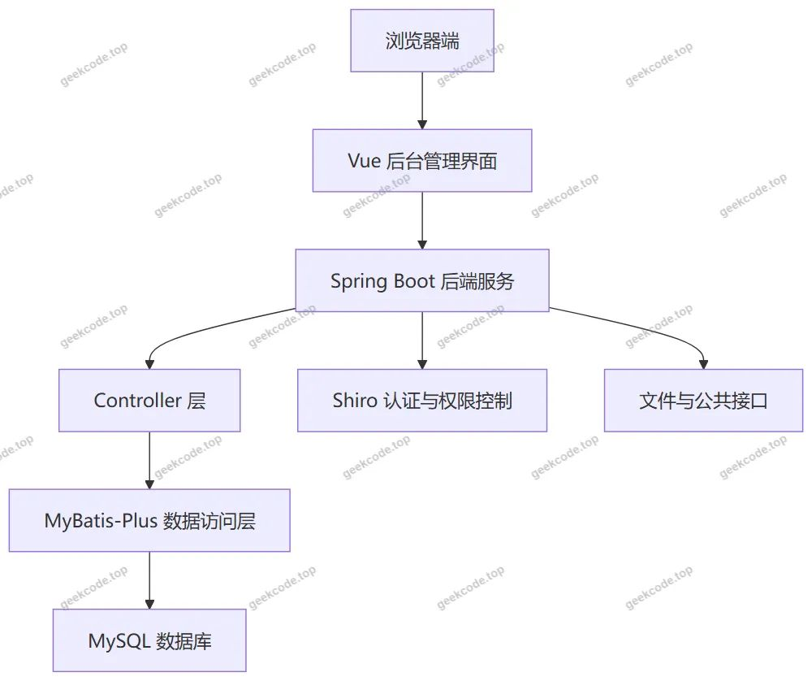
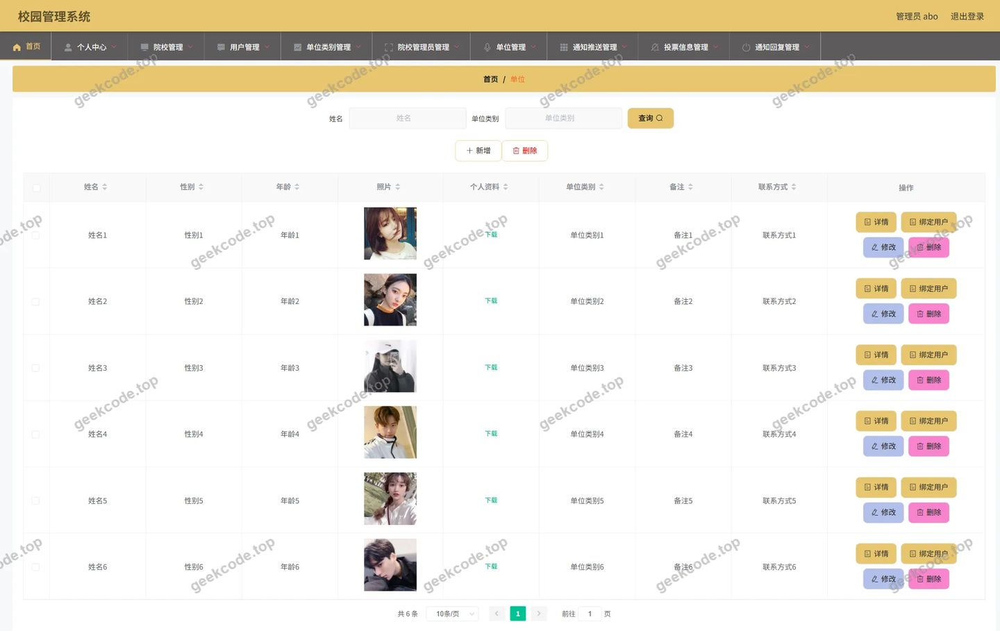
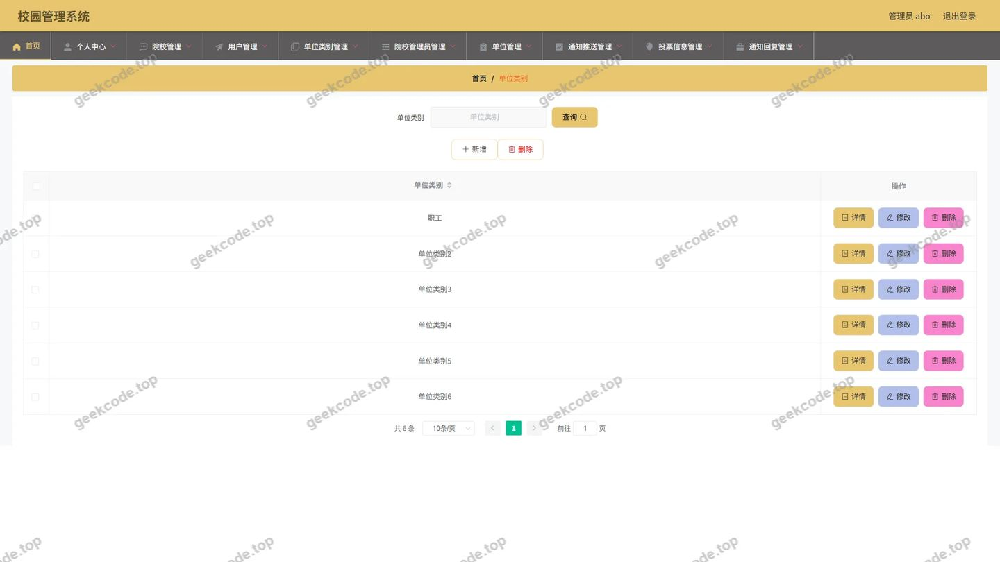
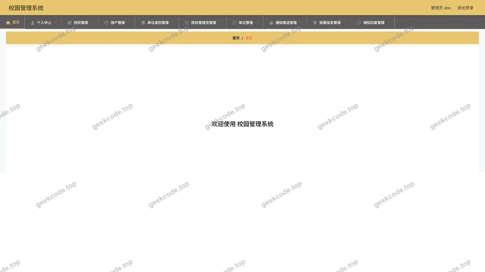
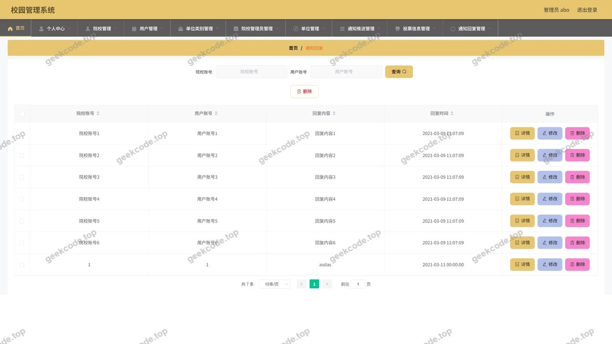
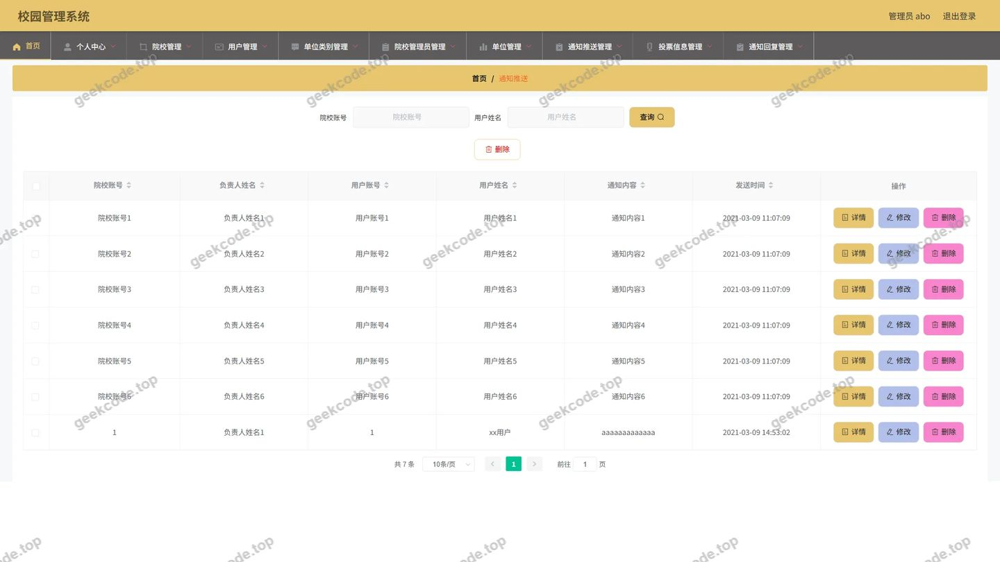
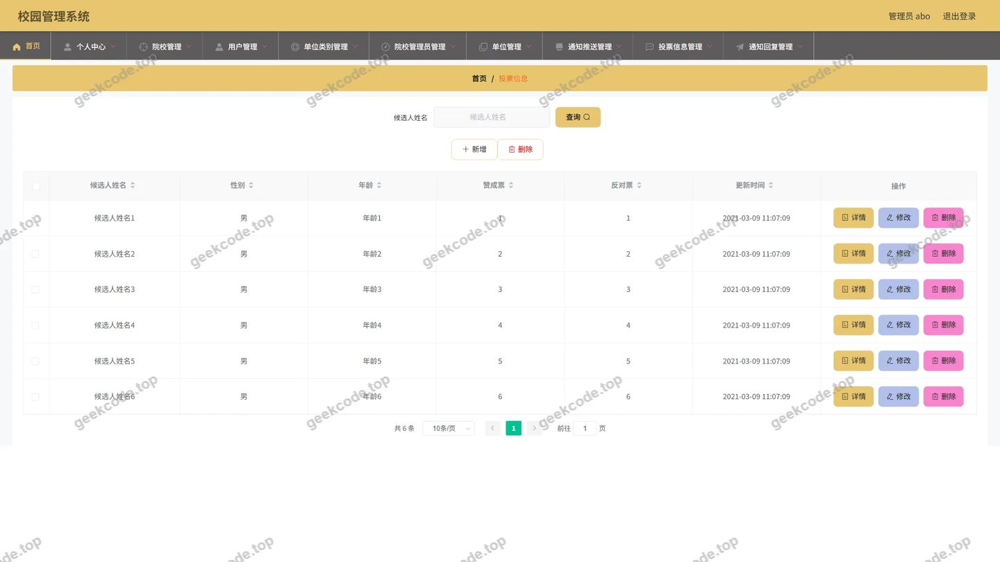
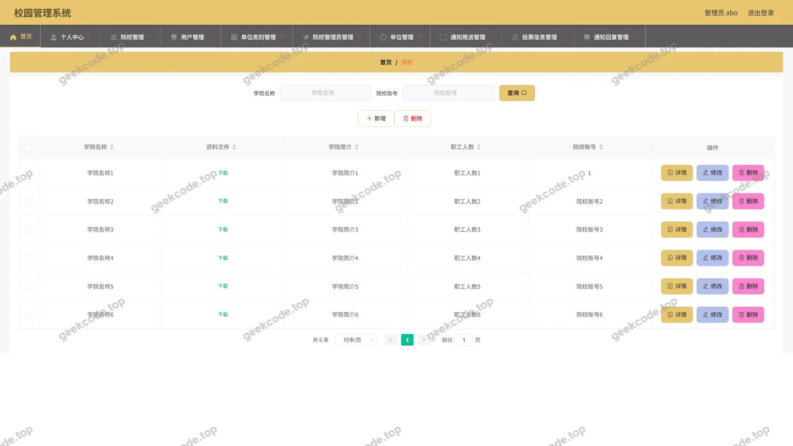
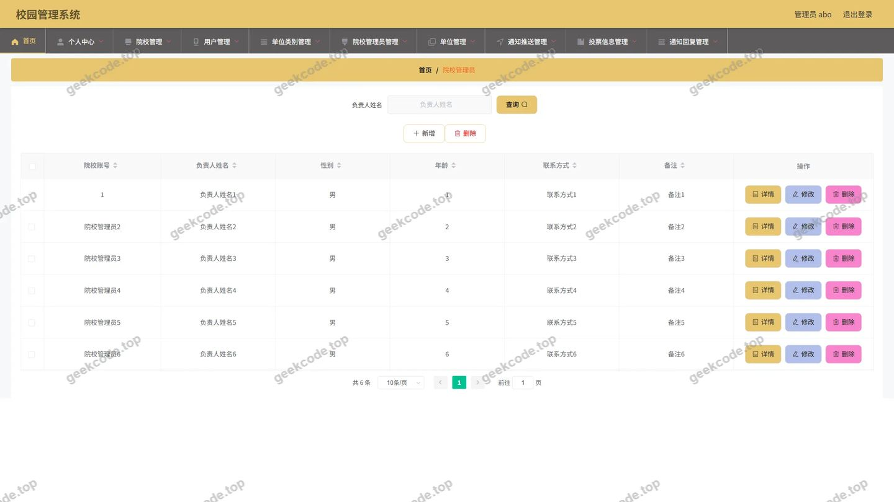

# 校园管理系统的设计与实现

> 🎓 **计算机毕业设计 · 校园管理系统的设计与实现**
>
> 本仓库只放**项目介绍 + 运行截图**（截图是站点带水印的原图，存在仓库 `images/` 里）。
>
> 👉 **完整可运行源码 / 数据库脚本 / 部署文档：[点我获取](https://geekcode.top/archives/%E6%A0%A1%E5%9B%AD%E7%AE%A1%E7%90%86%E7%B3%BB%E7%BB%9F%E7%9A%84%E8%AE%BE%E8%AE%A1%E4%B8%8E%E5%AE%9E%E7%8E%B0?utm_source=github)**
>
> 💬 咨询微信：**ir9372**　|　🌐 更多项目：[极客代码 geekcode.top](https://geekcode.top/?utm_source=github)
>
> 📌 项目详情页：<https://geekcode.top/archives/%E6%A0%A1%E5%9B%AD%E7%AE%A1%E7%90%86%E7%B3%BB%E7%BB%9F%E7%9A%84%E8%AE%BE%E8%AE%A1%E4%B8%8E%E5%AE%9E%E7%8E%B0?utm_source=github>

<table><td width="230" align="center"> <b>扫码加微信 ir9372</b></td><td valign="middle">📦 源码 = 项目介绍 + 全部运行截图 + 数据库 + 部署文档 👉 点上方任意截图，直接跳到 <b>极客代码 geekcode.top</b> 详情页</td></table>

---

<h1>校园管理系统的设计与实现</h1>
<h2>项目概述</h2>

校园管理系统面向校园行政与信息化管理场景，采用 Spring Boot、MyBatis-Plus 和 Shiro 构建后台管理端，并基于 Vue 集成前端页面。系统围绕院校、院校管理员、单位、单位类别、用户、投票信息、通知推送和通知回复等核心业务对象提供统一维护入口，帮助管理人员集中处理校园基础数据与通知投票事务。项目无前台用户端，主要适用于校园管理员或后台运营人员。后端通过 Spring Boot Web 提供接口，MyBatis-Plus 完成数据持久化，Shiro 支撑登录认证与访问控制，MySQL 负责数据存储。

<h2>技术架构</h2>

项目采用前后端一体化部署形式。前端为 Vue 后台管理界面，通过后台路由进入各管理模块；后端基于 Spring Boot Web 提供接口服务，使用 MyBatis-Plus 完成数据访问，使用 Shiro 实现登录认证与权限控制，使用 MySQL 作为数据库存储。

核心技术选型如下：

<ul>
<li><strong>Spring Boot</strong>：提供 Web 服务基础能力，组织 Controller、配置与接口运行环境。</li>
<li><strong>MyBatis-Plus</strong>：用于后端数据访问与持久层开发，降低数据库操作重复代码。</li>
<li><strong>Shiro</strong>：用于后台登录认证与访问控制，保障后台管理入口的安全性。</li>
<li><strong>MySQL</strong>：作为项目数据库，承载院校、单位、用户、通知、投票等业务数据。</li>
<li><strong>Vue 集成方案</strong>：项目类型为 vue-integrated，前端管理页面与后端应用形成一体化部署结构。</li>
<li><strong>validation-api</strong>：提供参数校验能力，用于接口入参规范化处理。</li>
<li><strong>commons-lang3</strong>：提供通用工具支持，辅助后端业务处理。</li>
<li><strong>protobuf-java</strong>：作为项目依赖之一，提供相关序列化或数据处理支持。</li>
</ul>

数据库设计围绕以下核心业务对象组织：

<ul>
<li>院校信息</li>
<li>院校管理员信息</li>
<li>单位信息</li>
<li>单位类别信息</li>
<li>用户信息</li>
<li>投票信息</li>
<li>通知推送信息</li>
<li>通知回复信息</li>
</ul>

业务对象之间存在管理与归属关系，例如单位与单位类别、通知推送与通知回复、院校与院校管理员等。具体表结构、字段定义、主键、外键和索引根据现有信息无法确定。

<h2>功能模块</h2>

本项目未设置前台用户端路由、前台导航菜单和个人中心菜单，因此前台用户端功能不纳入本次文档描述。

后台管理端功能模块如下：

<table>
<thead>
<tr>
<th>功能模块</th>
<th>对应路由或接口依据</th>
<th>功能描述</th>
</tr>
</thead>
<tbody><tr>
<td>后台登录页</td>
<td>后台登录页截图</td>
<td>系统管理员进入后台管理系统的认证入口。</td>
</tr>
<tr>
<td>后台首页</td>
<td>后台首页截图</td>
<td>后台管理页面的入口区域，用于进入各管理模块。</td>
</tr>
<tr>
<td>用户管理</td>
<td><code>/yonghu</code>、<code>YonghuController</code>、<code>UserController</code></td>
<td>对用户信息进行后台管理。</td>
</tr>
<tr>
<td>院校管理员管理</td>
<td><code>/yuanxiaoguanliyuan</code>、<code>YuanxiaoguanliyuanController</code></td>
<td>对院校管理员信息进行后台管理。</td>
</tr>
<tr>
<td>单位类别管理</td>
<td><code>/danweileibie</code>、<code>DanweileibieController</code></td>
<td>对单位类别信息进行后台管理。</td>
</tr>
<tr>
<td>单位管理</td>
<td><code>/danwei</code>、<code>DanweiController</code></td>
<td>对单位信息进行后台管理。</td>
</tr>
<tr>
<td>院校管理</td>
<td><code>/yuanxiao</code>、<code>YuanxiaoController</code></td>
<td>对院校信息进行后台管理。</td>
</tr>
<tr>
<td>投票信息管理</td>
<td><code>/toupiaoxinxi</code>、<code>ToupiaoxinxiController</code></td>
<td>对投票信息进行后台管理。</td>
</tr>
<tr>
<td>通知推送管理</td>
<td><code>/tongzhituisong</code>、<code>TongzhituisongController</code></td>
<td>对通知推送信息进行后台管理。</td>
</tr>
<tr>
<td>通知回复管理</td>
<td><code>/tongzhihuifu</code>、<code>TongzhihuifuController</code></td>
<td>对通知回复信息进行后台管理。</td>
</tr>
<tr>
<td>文件处理</td>
<td><code>FileController</code></td>
<td>提供文件相关后端接口能力。</td>
</tr>
<tr>
<td>系统配置</td>
<td><code>ConfigController</code></td>
<td>提供配置相关后端接口能力。</td>
</tr>
<tr>
<td>公共接口</td>
<td><code>CommonController</code></td>
<td>提供公共后端接口能力。</td>
</tr>
</tbody></table>
<h2>用户角色与权限</h2>

当前上下文中的后台路由与截图均指向 admin 管理入口，因此可确认的后台登录角色为系统管理员。

<table>
<thead>
<tr>
<th>角色</th>
<th>可访问入口</th>
<th>可访问功能模块</th>
<th>权限依据</th>
</tr>
</thead>
<tbody><tr>
<td>系统管理员（admin）</td>
<td>后台登录页、后台首页</td>
<td>用户管理、院校管理员管理、单位类别管理、单位管理、院校管理、投票信息管理、通知推送管理、通知回复管理</td>
<td>Shiro 登录认证与后台访问控制</td>
</tr>
</tbody></table>

院校管理员、用户在本项目上下文中主要作为后台管理对象存在，其独立登录入口与独立功能权限根据现有信息无法确定。

<h2>项目特色与创新点</h2>
<ul>
<li><strong>后台集中管理</strong>：将院校、单位、用户、通知、投票等校园管理信息统一纳入后台维护，减少分散管理带来的操作成本。</li>
<li><strong>前后端一体化结构</strong>：项目采用 vue-integrated 形式，后台管理页面与 Spring Boot 后端服务形成一体化部署结构。</li>
<li><strong>权限控制能力</strong>：基于 Shiro 提供后台登录认证与访问控制，适合毕业设计场景中的管理端安全设计。</li>
<li><strong>数据访问效率</strong>：使用 MyBatis-Plus 支撑持久层开发，便于围绕业务对象进行数据访问与维护。</li>
<li><strong>业务对象清晰</strong>：核心模块围绕校园管理常见实体展开，包括院校、院校管理员、单位、单位类别、用户、投票信息和通知信息。</li>
<li><strong>适用场景明确</strong>：项目无前台用户端，聚焦后台管理，适用于校园管理员或后台运营人员使用。</li>
</ul>
<h2>部署环境</h2>
<table>
<thead>
<tr>
<th>环境项</th>
<th>运行要求</th>
</tr>
</thead>
<tbody><tr>
<td>JDK</td>
<td>需要 Java 运行环境以启动 Spring Boot 后端服务；具体版本根据现有信息无法确定。</td>
</tr>
<tr>
<td>MySQL</td>
<td>需要 MySQL 数据库用于存储院校、单位、用户、通知、投票等业务数据。</td>
</tr>
<tr>
<td>Node.js</td>
<td>项目为 Vue 集成形式，需要 Node.js 用于前端构建；具体版本根据现有信息无法确定。</td>
</tr>
<tr>
<td>浏览器</td>
<td>需要浏览器访问后台登录页和各后台管理页面。</td>
</tr>
<tr>
<td>微信开发者工具</td>
<td>本项目未涉及微信小程序端，不需要微信开发者工具。</td>
</tr>
</tbody></table>
<h2>五、技术特性</h2>
<ul>
<li>前后端集成部署，前端资源打包至后端 static 目录</li>
<li>使用 MyBatis-Plus 简化数据访问层开发</li>
<li>集成 Shiro 权限框架实现角色权限控制</li>
</ul>
<h2>六、功能模块截图</h2>
<h3>后台管理端</h3>
<h4>后台-单位</h4>

<h4>后台-单位类别</h4>

<h4>后台首页</h4>

<h4>后台-登录</h4>

<h4>后台-通知回复</h4>

<h4>后台-通知推送</h4>

<h4>后台-投票信息</h4>

<h4>后台-院校</h4>

<h4>后台-院校管理员</h4>

---

## 获取完整源码

| 项目 | 说明 |
| --- | --- |
| 项目名 | 校园管理系统的设计与实现 |
| 运行截图 | 本文 10 张（站点带水印原图，仓库 `images/` 目录） |
| 完整源码 | [https://geekcode.top/archives/%E6%A0%A1%E5%9B%AD%E7%AE%A1%E7%90%86%E7%B3%BB%E7%BB%9F%E7%9A%84%E8%AE%BE%E8%AE%A1%E4%B8%8E%E5%AE%9E%E7%8E%B0?utm_source=github](https://geekcode.top/archives/%E6%A0%A1%E5%9B%AD%E7%AE%A1%E7%90%86%E7%B3%BB%E7%BB%9F%E7%9A%84%E8%AE%BE%E8%AE%A1%E4%B8%8E%E5%AE%9E%E7%8E%B0?utm_source=github) |
| 咨询微信 | **ir9372**（备注：jingpin-yuanma） |
| 更多项目 | [极客代码 geekcode.top](https://geekcode.top/?utm_source=github) |

> 需要源码、部署、改配置、跑不起来等问题，加微信 ir9372 沟通，说明项目名即可。
